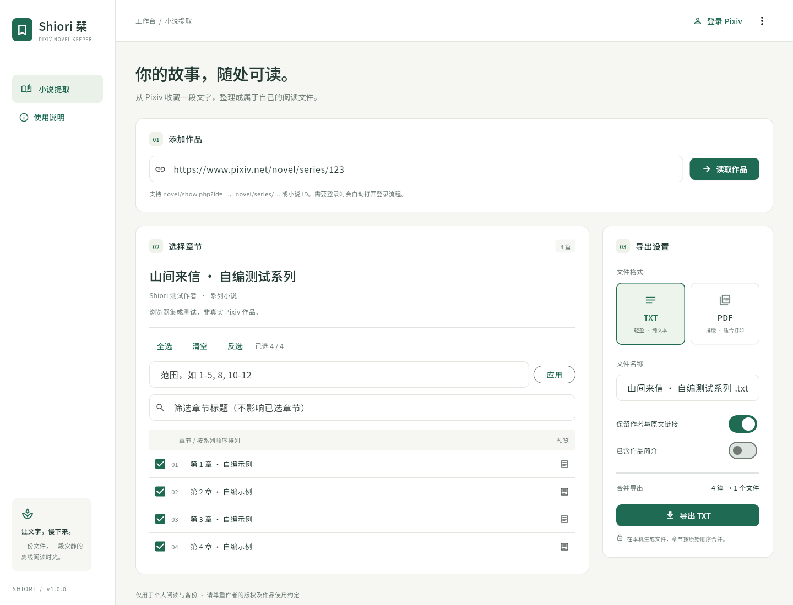

# Shiori 栞

**为喜爱的文字，留一枚书签。**

使用 Flutter 构建的 Pixiv 小说提取器。在本机读取有权访问的小说，选择系列中的部分章节，按原始顺序合并成 TXT 或 PDF。

## 功能

- 单篇、系列链接及小说 ID；支持语言前缀与分享链接中的跟踪参数。
- 完整系列目录，逐章勾选、全选、清空、反选、标题筛选，或输入 `1-5, 8, 10-12`。
- 筛选只改变显示，不改变已选章节；范围使用目录中的一基序号，不是小说 ID。
- 正文预览；UTF-8（带 BOM）TXT；嵌入中日文字体的 A4 PDF，可调整字号。
- 保留作者、原文链接与作品简介的选项；所选章节合并成一个文件。
- 转换 Pixiv 章节、分页、注音、跳转与插图标记；未知标记原样保留。
- 明确要求登录时打开登录流程，并重试一次。登录、验证码与访问权限由 Pixiv 控制。
- 顺序读取、限速、429 / 服务错误有限重试、取消操作；任何所选章节失败都不会保存半份文件。
- 会话与正文缓存只驻留内存，无遥测，无第三方小说转发后端。



截图中的系列与正文为自行编写的测试数据，不是第三方小说。

## 下载与平台

本仓库已从原始 v1.0.0 交付资料恢复完整源码与 Git 历史，包含各平台工程、字体、测试和打包脚本。安装包的实际可用范围以 Releases 中已有附件为准；表格列出各平台的交付形式，不代表每个平台都已发布二进制文件。源码可直接克隆：

```sh
git clone https://github.com/Jay-Void-BA/Pixiv-novel-extractor.git
cd Pixiv-novel-extractor
```

从仓库 [Releases](https://github.com/Jay-Void-BA/Pixiv-novel-extractor/releases) 下载附件；[Actions](https://github.com/Jay-Void-BA/Pixiv-novel-extractor/actions) 可查看构建结果。桌面包需要保留整个解压目录，不要只复制可执行文件。`SHA256SUMS.txt` 可校验附件完整性。

| 平台 | 交付形式 | 运行 / 安装 |
| --- | --- | --- |
| Android 7.0+ | 发布密钥签名 APK | 安装 `shiori-android.apk` |
| iOS 15+ | 未签名 `Runner.app` + 源码 | 需自行签名，不能直接安装 |
| Linux x64 | GTK 3 桌面包，Ubuntu 24.04 构建 | 解压 `.tar.gz`，运行 `./shiori`；[运行说明](docs/LINUX.md) |
| macOS 12+ | `.app` ZIP，文件名标明架构 | 解压后右键打开；未做 Developer ID 公证 |
| Windows 10/11 x64 | 桌面 ZIP | 运行 `shiori.exe`；可能需 VC++ 2015–2022 x64 运行库 |
| FreeBSD | Flutter Web + Python 本地服务 | Python 3.10+、现代 Chromium / Firefox；[启动说明](docs/FREEBSD.md) |

FreeBSD 不在 [Flutter 官方原生支持列表](https://docs.flutter.dev/reference/supported-platforms) 中，采用相同 Flutter UI 的本地 Web 版本，**不是 FreeBSD 原生 ELF**。Web 包包含本地渲染器和字体，访问 Pixiv 仍需网络。服务仅监听 `127.0.0.1`。

## 使用

完整安装步骤、选章合并、登录和常见问题见 [中文使用方法](docs/USAGE.zh-CN.md)。

1. 粘贴 `https://www.pixiv.net/novel/show.php?id=…`、`https://www.pixiv.net/novel/series/…` 或小说 ID，点击「读取作品」。
2. 勾选所需章节，或输入范围后点击「应用」。
3. 选择 TXT / PDF、文件名及元数据选项，点击导出。章节始终按原始目录顺序合并。
4. 桌面打开保存对话框；手机打开系统分享 / 保存界面；Web 版下载文件。取消保存后可「再次保存」。

### 登录

浏览器 Cookie 不能被另一个普通应用直接读取。本项目明确实现以下路径：

- **Android / iOS**：自动打开应用内浏览器，加载 Pixiv 官方 HTTPS 登录页面。完成登录后，通过系统 WebView Cookie API 获取 `PHPSESSID` 并返回提取界面。应用不接收或记录密码。若 Pixiv 拒绝嵌入式浏览器，使用备用导入入口。
- **桌面 / FreeBSD Web**：自动唤起系统浏览器，打开带随机令牌的本机连接页。需预先加载 Release 的 [Shiori Bridge](browser_extension/README.md) 扩展；在扩展确认页允许连接，再在 Pixiv 官方网站登录。扩展只将 `PHPSESSID` 发往本机。已有登录状态可直接连接当前会话。连接五分钟后过期。
- **备用导入**：右上角菜单 →「导入会话」。从已登录 Pixiv 的浏览器开发者工具 → Application / Storage → Cookies 复制 `PHPSESSID` 的**值**。不需要完整 Cookie 字符串。此值相当于账号访问凭据，不要分享。

扩展未在商店分发。Chromium 系加载解压目录；普通 Firefox 临时加载扩展，重启需重载，持续安装需要自行签名。手机不依赖此扩展。

登录不会解锁原本无权访问、已删除或受限制的作品。403 也可能是风控，不会无限循环登录。退出会话会清除应用会话、正文缓存及待保存文件；已导出文件与外部浏览器的登录状态由你管理。

### iOS 自行签名

CI 使用 `flutter build ios --release --no-codesign`，交付未签名 `.app` ZIP，不能当作可直接安装的 IPA。推荐从源码安装：

```sh
flutter pub get
open ios/Runner.xcworkspace
```

在 Xcode 的 Runner → Signing & Capabilities 选择自己的 Team，按需修改 Bundle ID，连接设备构建。若有分发证书与描述文件，可运行 `flutter build ipa --export-options-plist=<你的配置>`。不要将证书与密码提交到仓库。

## 开发与测试

开发环境、修改流程和平台要求见 [开发指南](CONTRIBUTING.md)；目录与模块职责见 [完整项目结构](docs/PROJECT_STRUCTURE.md)。

固定使用 **Flutter 3.47.9 / Dart 3.13.7**，依赖锁定于 `pubspec.lock`。宿主机需安装 [对应平台工具链](https://docs.flutter.dev/platform-integration)。

```sh
flutter pub get --enforce-lockfile
dart format --output=none --set-exit-if-changed lib test
flutter analyze --fatal-infos
flutter test --coverage
python3 -m unittest discover -s test -p 'test_*.py' -v
node --test test/extension_test.cjs
flutter run -d linux  # 也可用 macos / windows / 设备 ID
```

本地 Web / FreeBSD：

```sh
flutter build web --release --no-web-resources-cdn
python3 freebsd/shiori_server.py --web-root build/web
# 生成可分发包：
python3 tool/package_web.py
python3 tool/package_extension.py
```

可选浏览器集成测试（自行编写的模拟系列，验证真实 UI 与 TXT/PDF 下载）：

```sh
python3 -m pip install playwright==1.62.0
python3 -m playwright install chromium
python3 tool/browser_smoke.py
```

普通静态托管无法跨域请求 Pixiv，必须通过随包本地服务启动。该服务只代理固定的只读小说接口，保持 TLS 验证，没有任意 URL 转发接口。

测试使用自编模拟数据，不包含真实 Cookie 或第三方小说全文。覆盖链接与范围校验、超过 30 章的系列、选择顺序、失败中止、会话清理、TXT 编码、长文 CJK PDF、手机 / 桌面布局，以及本地服务的令牌、来源、路径与过期会话。CI 另在 FreeBSD VM 执行服务测试。真实账号登录、验证码与各平台真机交互仍需用户环境验证。

## CI / Release

[交付工作流](.github/workflows/delivery.yml) 在 main、PR 与版本标签上运行：

1. 格式检查、静态分析、Flutter / Python / Node 测试；构建 Web 与浏览器扩展。
2. Linux、Windows、macOS、iOS、Android 原生构建，以及 FreeBSD VM 服务测试。
3. 全部成功且触发源是 `v*` 标签时，检查预期附件、生成 SHA-256 校验文件，再创建 Release。

Android 版本标签要求仓库 Actions Secrets：

| Secret | 内容 |
| --- | --- |
| `SHIORI_KEYSTORE_BASE64` | JKS 发布密钥库的 Base64，别名必须为 `shiori` |
| `SHIORI_KEYSTORE_PASSWORD` | 密钥库及私钥共同密码 |

请备份原始密钥并在后续版本持续使用，以保证升级兼容。无密钥的分支构建使用调试签名；版本标签直接失败，防止误发。密钥只恢复到 runner 临时目录，构建后删除。

```sh
git tag v1.0.0
git push origin v1.0.0
```

工作流不签名 iOS，不对 macOS 做 Developer ID 签名 / 公证，不对 Windows 做 Authenticode 签名，也不上传任何应用或扩展商店。

## 结构与边界

```text
android/ ios/       Android 与 iOS 宿主工程
linux/ macos/       Linux 与 macOS 宿主工程
windows/ web/       Windows 宿主工程与 Web 启动资源
assets/fonts/       TXT/PDF 与界面使用的中日文字体及许可
lib/core/           链接、目录、请求、正文转换、TXT/PDF
lib/platform/       登录、浏览器连接、Web 本机传输与文件保存
lib/main.dart       响应式 Flutter UI
browser_extension/  经授权的 Pixiv → 本机会话连接
freebsd/            Python 标准库本地 Web 服务
test/               Flutter / Python / Node 测试
tool/               打包与 Release 完整性检查
docs/               使用方法、平台说明、结构说明与验证记录
.github/workflows/  多平台构建、测试与版本发布
```

完整目录、调用关系与生成文件说明见 [项目结构](docs/PROJECT_STRUCTURE.md)。[迁移记录](docs/MIGRATION.md) 保存源文件校验值与本次复核结果；[更新记录](CHANGELOG.md) 记录版本内容。

Pixiv 的 Web AJAX 接口未公开且可能变化；参考 [PixivNow 接口记录](https://github.com/FreeNowOrg/PixivNow/blob/master/docs/pixiv-web-api.md)。`content_titles` 返回完整系列目录，不是按 30 条分页的 `series_content`。目录数量不符或重复会停止加载，避免静默缺章。

插图以原文链接 / 占位文字保留，不嵌入图片。暂不提供 EPUB 或云端同步。PDF 使用 Noto Sans SC，覆盖常见中日文字；罕见字符和 Emoji 的显示取决于字体字形。

## 隐私与许可

请求仅发往 Pixiv 及本机服务。无遥测、远程日志、账号注册或凭据云存储。退出清除内存数据。本地服务限制 Host / Origin、固定上游接口并拒绝目录穿越；连接令牌不写入访问日志。

应用源码 [BSD-2-Clause](LICENSE)；字体 [SIL Open Font License](assets/fonts/OFL.txt)。依赖的开源许可随 Flutter 构建产物分发。

本项目与 Pixiv 无隶属关系。请仅保存有权访问的作品，尊重作者版权及平台约定，不再分发他人作品。
